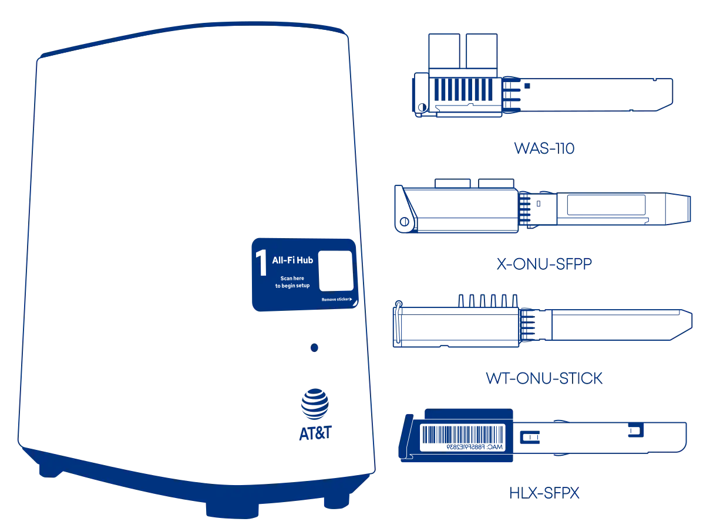

# Masquerade as the AT&T Inc. BGW620-700 with the WAS-110 or HLX-SFPX

{ class="nolightbox" }

<!-- more -->
<!-- nocont -->









## Configure ONT settings

To masquerade, you will need the original ONT serial number and other identifiers (e.g., software versions) from your
{{ page.meta.ont }}'s fiber stats page, as well as the bottom label.

<http://192.168.1.254/cgi-bin/fiberstat.ha>

=== "WAS-110 / X-ONU-SFPP"

    Use your preferred setup method and carefully follow the steps to avoid unnecessary downtime and troubleshooting:

    * [Web (luci)](#config-via-web)
    * [Shell (linux)](#config-via-shell)

    <h3 id="config-via-web">Via web <small>recommended</small></h3>

    <div class="swiper" markdown>

    <div class="swiper-slide" markdown>

    { loading=lazy }

    </div>

    <div class="swiper-slide" markdown>

    { loading=lazy }

    </div>

    <div class="swiper-slide" markdown>

    { loading=lazy }

    </div>

    <div class="swiper-slide" markdown>

    { loading=lazy }

    </div>

    </div>

    1. Within a web browser, navigate to
       <https://192.168.11.1/cgi-bin/luci/admin/8311/config>
       and, if asked, input your *root* [password]{ data-preview target="_blank" }.

    2. From the __8311 Configuration__ page, on the __PON__ tab, fill in the configuration with the following values:

        !!! info "All attributes below are <ins>mandatory</ins>"
            Replace the ONT ID with the one found on the {{ page.meta.ont }}'s label.

        | Attribute                  | Value                   | Remarks                                       |
        | -------------------------- | -----------------       | --------------------------------------------- |
        | PON Serial Number (ONT ID) | COMM&hellip;            | Replace with the ONT ID from the bottom label |
        | Equipment ID               | iONT620700X             |                                               |
        | Hardware Version           | BGW620-700_2.5          |                                               |
        | Sync Circuit Pack Version  | :check_mark:            |                                               |
        | Software Version A         | BGW620_5.31.9           | [Version listing]                             |
        | Software Version B         | BGW620_5.31.9           | [Version listing]                             |
        | MIB File                   | /etc/mibs/prx300_1U.ini | PPTP i.e. default value                       |

    3. From the __8311 Configuration__ page, on the __ISP Fixes__ tab, enable __Fix VLANs__ from the drop-down.

    4. __Save__ changes and *reboot* from the __System__ menu.

    <h3 id="config-via-shell">Via shell <small>alternative</small></h3>

    1. Login over secure shell (SSH).

        ``` sh
        ssh root@192.168.11.1
        ```

    2. Configure the 8311 U-Boot environment.

        !!! info "All attributes below are <ins>mandatory</ins>"

        ``` sh
        fwenv_set -8 gpon_sn COMM...
        fwenv_set -8 equipment_id iONT620700X
        fwenv_set -8 hw_ver BGW620-700_2.5
        fwenv_set -8 cp_hw_ver_sync 1
        fwenv_set -8 sw_verA BGW620_5.31.9
        fwenv_set -8 sw_verB BGW620_5.31.9
        fwenv_set -8 fix_vlans 1
        ```

        !!! info "Additional details and variables are described at the original repository [^1]"
            `/usr/sbin/fwenv_set` is a helper script that executes `/usr/sbin/fw_setenv` twice consecutively.

            The WAS-110 functions as an A/B system, requiring the U-Boot environment variables to be set twice, once
            for each environment.

            The `-8` option prefixes the U-Boot environment variable with `8311_`.

    3. Verify the 8311 U-boot environment and reboot.

        ``` sh
        fw_printenv | grep ^8311
        reboot
        ```

  [password]: ../xgs-pon/ont/bfw-solutions/was-110.md#web-credentials

=== "HLX-SFPX"

    { loading=lazy }

    1. Within a web browser, navigate to <http://192.168.33.1/cgi-bin/luci/admin/system/halny-settings/> and, if asked,
       input the *useradmin* [web credentials]{ data-preview target="_blank" }.
    3. From the hidden __HALNy Settings__ page, in the __Custom values__ section, fill in the configuration with the
       following values:

        !!! info "All attributes below are <ins>mandatory</ins>"
            Replace the PON Serial Number with the ONT ID found on the {{ page.meta.ont }}'s label.

        | Parameter                  | Value                   | Remarks                                       |
        | -------------------------- | -----------------       | --------------------------------------------- |
        | State                      | Enable                  |                                               |
        | PON Serial Number          | COMM&hellip;            | Replace with the ONT ID from the bottom label |
        | Equipment ID               | iONT620700X             |                                               |
        | Hardware Version           | BGW620-700_2.5          |                                               |
        | Sync Circuit Pack Version  | Enable                  |                                               |
        | Software Version A         | BGW620_5.31.9           | [Version listing]                             |
        | Software Version B         | BGW620_5.31.9           | [Version listing]                             |

    4. Click __Save & Reboot__ to apply the parameters.

  [web credentials]: ../xgs-pon/ont/calix/100-05610.md#web-credentials
  [Version listing]: #software-versions





### IPv6

AT&T's DHCPv6 server may only respond to the {{ page.meta.ont }}'s DUID, the identifier a DHCPv6 client sends with
its requests. If your router is not receiving an IPv6 address or prefix delegation, you must __clone the
{{ page.meta.ont }} WAN DUID onto your router's DHCPv6 client.__

The WAN DUID is made up of the following:

| Attribute         | Value            | Remarks                                   |
| ----------------- | ---------------- | ----------------------------------------- |
| DUID type         | `00:02`          | DUID-EN                                   |
| Enterprise number | `00:00:0d:e9`    | 3561                                      |
| Identifier        | `<OUI>-<SERIAL>` | ASCII string e.g. `AABBCC-12345678901234` |

`<OUI>` is the first six (6) hex digits of the {{ page.meta.ont }} __MAC address__ in uppercase without separators,
and `<SERIAL>` is its serial number, <ins>not</ins> the ONT ID.

!!! warning "The DUID sent by the {{ page.meta.ont }}'s LAN DHCPv6 server is different and will <ins>NOT</ins> work"

To generate the DUID, <ins>replace</ins> `<OUI>-<SERIAL>` and execute the following command from a Linux, macOS, or
FreeBSD shell:

``` sh
printf '%s' '<OUI>-<SERIAL>' | od -An -v -tx1 | tr -d ' \n' | sed 's/../:&/g;s/^/00:02:00:00:0d:e9/'
```

``` sh title="Example: AABBCC-12345678901234"
00:02:00:00:0d:e9:41:41:42:42:43:43:2d:31:32:33:34:35:36:37:38:39:30:31:32:33:34
```

#### :simple-pfsense: pfSense { #ipv6-pfsense data-toc-label="pfSense" }

1. Navigate to __System > Advanced > Networking__.
2. From the __DHCP6 DUID__ drop-down, select __Raw DUID__, paste the generated DUID, and click __Save__.
3. Reboot or reconfigure the WAN interface for the new DUID to take effect.

!!! note "The saved DUID will start with its length e.g. `1b:00:`, which is expected"

!!! info "Be patient..."
    It may take several minutes before AT&T responds. Once it does, you should receive the same /128 WAN address and
    /60 prefix delegation as the {{ page.meta.ont }}.



## Software versions

The {{ page.meta.ont }} uses CWMP instead of OMCI for firmware updates. While the OLT rarely requires approval for
specific software versions, keeping the [WAS-110] up-to-date is beneficial but not strictly necessary.

1. Within a web browser, navigate to
   <http://192.168.1.254/cgi-bin/update.ha>
2. Copy/paste the __Current software version__ into the form to generate a __Software Version__ attribute.
   <div style="margin:1em 0;">
     <form onsubmit="(function(e){e.preventDefault();var f=e.currentTarget,el=f.elements.softver;if(!el.checkValidity())return;el.value='BGW620_'+el.value;})(event)">
       <input type="text" id="softver" placeholder="Current Version" pattern="^\d\.\d{2}\.\d$"/>
       <input type="submit" value="Generate" />
     </form>
   </div>

{{ read_csv('docs/posts/masquerade-as-the-att-inc-bgw620-700-with-the-was-110/versions.csv') }}

[^1]: <https://github.com/djGrrr/8311-was-110-firmware-builder>
